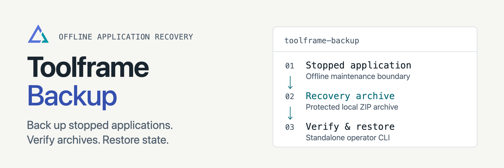

<p align="center">
<picture>
  <source media="(prefers-color-scheme: dark)" srcset="docs/assets/readme-banner-dark.png">
  <source media="(prefers-color-scheme: light)" srcset="docs/assets/readme-banner-light.png">
  
</picture>
</p>

# Toolframe Backup

[](https://github.com/toolframe/toolframe-backup/actions/workflows/ci.yml?query=branch%3Amain)

Create recovery archives of cleanly stopped Toolframe applications.
A standalone CLI verifies and restores archives; the optional plugin adds a backup catalog.

## Quick start

Use Python 3.14+ and the operator extra. Stop the application's host and workers
cleanly before creating an archive:

```sh
uv venv --python 3.14
uv pip install 'toolframe-backup[operator]==0.2.2'
.venv/bin/toolframe-backup create --home ./app --directory ./backups
.venv/bin/toolframe-backup list --directory ./backups
```

Use the returned archive path with `verify` and `restore`; follow
[backup and recovery](docs/operations.md) for exact commands and prerequisites.
Restore requires a new destination and reconstructs recorded environments.

**Limits:** archives are unencrypted and contain private keys, configuration and
data. Local files and SQLite stores are supported; live applications, external
SQL and remote attachments are rejected. Restore may need exact dependency wheels
from the network; offline recovery requires a complete local wheelhouse.

## Guides

| I want to… | Start here |
| --- | --- |
| Create, verify or restore archives | [Operations and limits](docs/operations.md) |
| Use the Dashboard/MCP catalog | [Catalog guide](src/toolframe_backup/docs/usage.md) |
| Understand archive boundaries | [Architecture](docs/architecture.md) |
| Contribute or run checks | [Contributing](CONTRIBUTING.md) · [Verification](docs/development.md) |
| Publish a package | [Releasing](docs/releasing.md) |

[Releases](https://github.com/toolframe/toolframe-backup/releases)

## License

[Apache 2.0](LICENSE), with [NOTICE](NOTICE).
